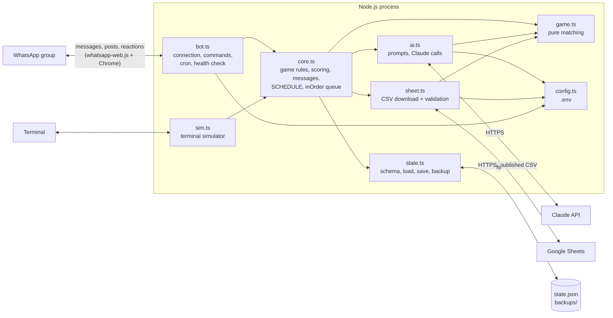

# Architecture

How scripture-challenge is put together today, where untrusted data crosses into it, and the
layout we're moving toward. The rules the code must keep (I1–I6) are in [AGENTS.md](../AGENTS.md).

## 1. Current architecture

One Node.js process, run by pm2 on a single server. All game state is one JSON file.



`types.ts` (books, shared types) is imported by most files and is left off the diagram.

### Daily schedule

The source of truth is `SCHEDULE` in `src/core.ts`; `bot.ts` runs it with node-cron in the
`TZ_NAME` time zone (default `America/New_York`). If you change one, change this table too.

| Time | Cron | Job |
|---|---|---|
| 6:50 AM daily | `50 6 * * *` | Reminder: puzzle in 10 minutes |
| 6:55 AM daily | `55 6 * * *` | Back up `state.json` to `backups/` (no post) |
| 7:00 AM daily | `0 7 * * *` | Morning puzzle |
| 9:50 AM daily | `50 9 * * *` | Reminder: Bible Riddle (only with a Riddles tab) |
| 10:00 AM daily | `0 10 * * *` | Bible Riddle opens |
| 12:00 PM daily | `0 12 * * *` | Bible Riddle closes (answer shown if unsolved) |
| 12:00 PM daily | `0 12 * * *` | First hint, written by AI; the speed bonus ends |
| 1:50 PM daily | `50 13 * * *` | Reminder: Midday Review (only once there are enough old verses) |
| 2:00 PM daily | `0 14 * * *` | Midday Review opens |
| 5:00 PM daily | `0 17 * * *` | Midday Review closes (answer shown if unsolved) |
| 6:00 PM daily | `0 18 * * *` | Last hint: the book |
| 6:50 PM daily | `50 18 * * *` | Reminder: Emoji Bible (only with a Stories tab) |
| 7:00 PM daily | `0 19 * * *` | Emoji Bible opens |
| 8:00 PM daily | `0 20 * * *` | Emoji Bible closes (answer shown if unsolved) |
| 8:00 PM Dec 31 | `0 20 31 12 *` | Season finale leaderboard |
| 8:05 PM Sundays | `5 20 * * 0` | Weekly wrap leaderboard |
| 9:00 PM daily | `0 21 * * *` | Morning puzzle answer revealed if unsolved |

node-cron doesn't catch up: a job whose minute passes while the bot is down or restarting is
skipped. Don't deploy in the 10 minutes before a game.

### Trust boundaries

**Where player text enters.** Only `onMessage` in `src/bot.ts`, for messages in `GROUP_ID`:

- the message text → `core.handleMessage` → `game.ts` matching (`parseReference`, `matchesDecode`,
  `startsVerse`, `quotesVerse`, `namesStory`), and on to the AI in `aiReadGuess`,
  `judgeRiddleGuess` and `judgeStoryGuess`;
- the WhatsApp display name (`pushname`, set by the player) → stored in `state.json` and sent to
  the AI in `celebrate`;
- the message timestamp (`msg.timestamp`) → the speed bonus and Quick Draw;
- the sender ID → admin commands when it equals `ADMIN_ID`.

**Where sheet content enters.** `sheet.ts` validates the shape of each row with Zod, but the text
(clues, verses, hints, riddles, stories, answers) is posted to the group as written and goes into AI prompts.

**Where AI output enters.**

| Call | Output goes to | Deterministic check |
|---|---|---|
| `aiReadGuess` | a guessed reference | Yes: Zod, `findBook`, then `isCorrect` against the answer, which the AI never sees |
| `judgeRiddleGuess`, `judgeStoryGuess` | **points and closing the game** | **No.** A `correct` verdict wins outright (known violation of I1; `AI_JUDGING=off` disables it) |
| `makeHint` | posted to the group | None |
| `celebrate` | posted to the group, inside the win message | None |
| `makeEmoji` | posted to the group as the Emoji Bible clue | Rejects ASCII letters and digits only |

**Where state is written.** Only `state.save()` in `src/state.ts` (write to a temp file, then
rename), always called inside the `inOrder` queue in `src/core.ts` (I2). `state.backup()` copies
the file at 6:55. Read-only commands (`!leaderboard`, `!me`, `!today`, …) load it outside the
queue, which is safe because saves are atomic.

The open violations of I1 and I4 are listed under "Known violations" in AGENTS.md.

## 2. Target architecture

The game logic, the use cases, the AI and the outside world each get their own folder, so each
can be tested and changed on its own. This is the direction for the migration, not a big-bang
rewrite: files move one at a time, with tests passing at every step.

```
src/
  domain/          pure rules: matching, scoring, streaks, badges, points, types. No I/O.
  application/     use cases (newPuzzle, handleMessage, hint, reveal, the three extra games,
                   leaderboards, messages), the inOrder queue, SCHEDULE, and the port interfaces
  ai/              prompts and Claude calls, implementing the AI ports
  infrastructure/  state.json store, Google Sheets, WhatsApp transport, cron, .env config
  bot.ts           entry point: builds the ports and starts the bot
  sim.ts           entry point: builds the ports and starts the terminal simulator
```

| Today | Target |
|---|---|
| `game.ts`, `types.ts` | `domain/` |
| scoring, streak and badge rules, point constants in `core.ts` | `domain/` |
| use cases, messages, `SCHEDULE`, `inOrder` in `core.ts` | `application/` |
| `ai.ts` | `ai/` |
| `state.ts`, `sheet.ts`, `config.ts` | `infrastructure/` |
| WhatsApp client, cron, health check in `bot.ts` | `infrastructure/`; `bot.ts` keeps only the wiring |

### Ports

A port is a plain TypeScript interface that `application/` declares and something outside
implements. The entry point builds one object holding every implementation and passes it in.
There's no DI framework, decorators or container: tests pass an object of fakes.

```ts
// application/ports.ts
export interface StateStore { load(): State; save(s: State): void; backup(now: Date): string | null }
export interface ContentSource { scriptures(): Promise<Scripture[]>; stories(): Promise<Story[]>; riddles(): Promise<Riddle[]> }
export interface AiJudge {
  readGuess(text: string): Promise<Guess | null>;
  judgeStory(text: string, story: Story): Promise<Verdict>;
  judgeRiddle(text: string, riddle: Riddle): Promise<Verdict>;
}
export interface AiWriter { hint(v: Scripture): Promise<string>; cheer(name: string, ref: string): Promise<string>; emoji(story: string): Promise<string> }
export interface Clock { now(): number }

export interface Ports { state: StateStore; content: ContentSource; judge: AiJudge; writer: AiWriter; clock: Clock }

// application/game.ts
export function createGame(ports: Ports) {
  return { newPuzzle, handleMessage, hint, reveal /* ... */ };
}

// bot.ts
const game = createGame({ state: fileStateStore("state.json"), content: googleSheets(urls),
  judge: claudeJudge(client), writer: claudeWriter(client), clock: { now: Date.now } });
```

### Dependencies point inward

```
bot.ts, sim.ts  ──►  infrastructure/, ai/  ──►  application/  ──►  domain/
```

- **`domain/` imports nothing** from the other layers, and no Node or npm packages that do I/O.
- **`application/`** imports `domain/` only. It reaches the outside world through `Ports`.
- **`ai/` and `infrastructure/`** import `application/` (to implement its ports) and `domain/` types.
- **Only the entry points** import `infrastructure/` and `ai/`.

Once the folders exist, a test will check these imports so a PR can't quietly break the rule.

## 3. What we deliberately don't do

- **No database yet.** One process, one group, and about one write per message fit comfortably in
  a JSON file saved atomically, backed up daily and off-site. Revisit if we run several groups,
  need several processes, or `state.json` gets big enough that loading it on every message is slow.
- **No microservices.** One bot, one server, one maintainer. Splitting it would add network calls,
  deploys and failure modes without making anything easier. The layers above give us the separation.
- **No framework.** No web, bot or DI framework. Plain TypeScript functions and interfaces are enough,
  keep dependencies few (I6), and keep the code readable to anyone who knows TypeScript.
